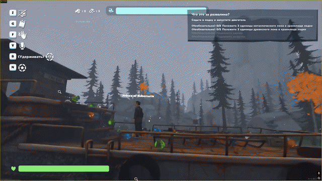
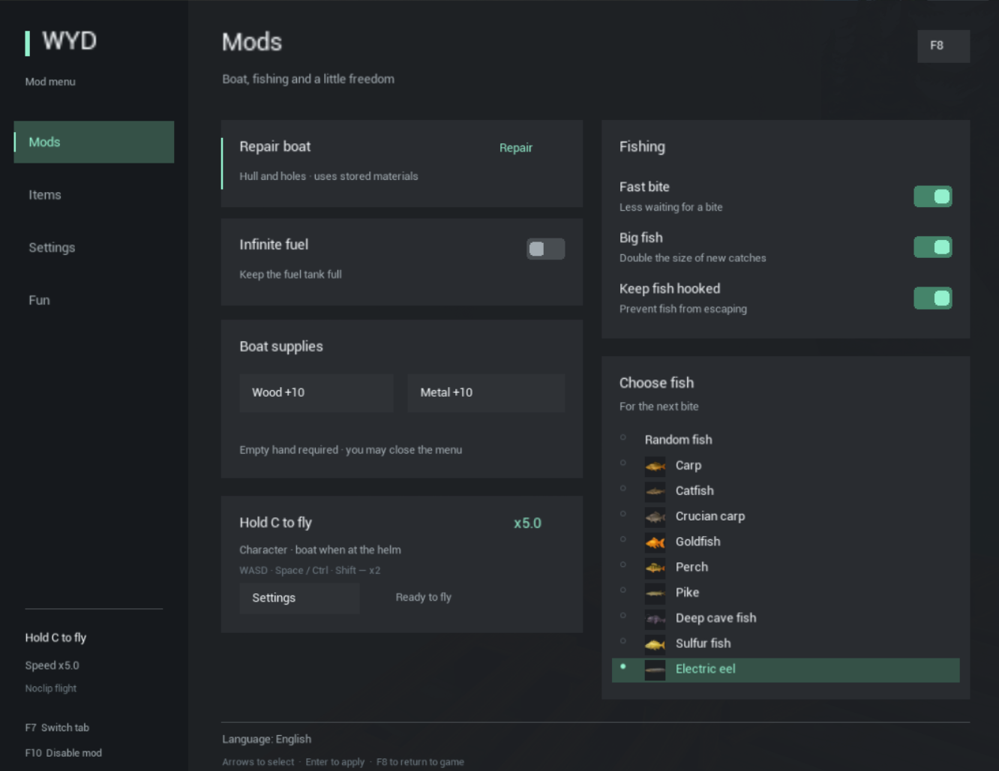
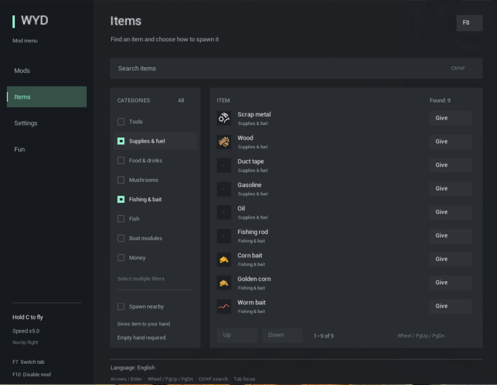
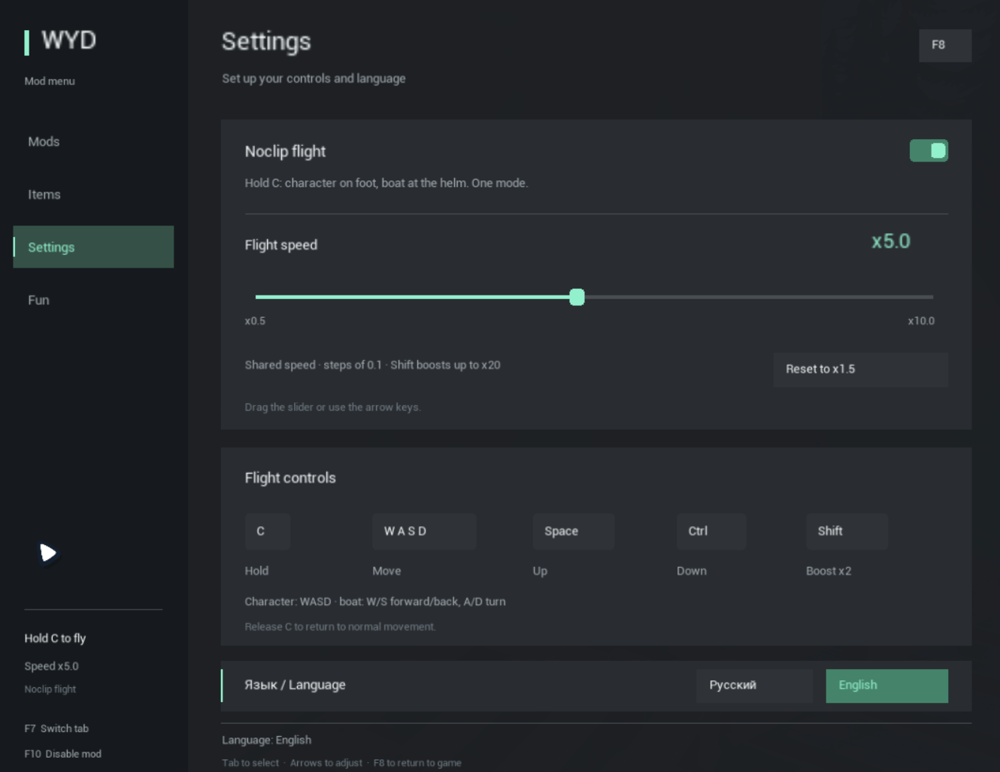
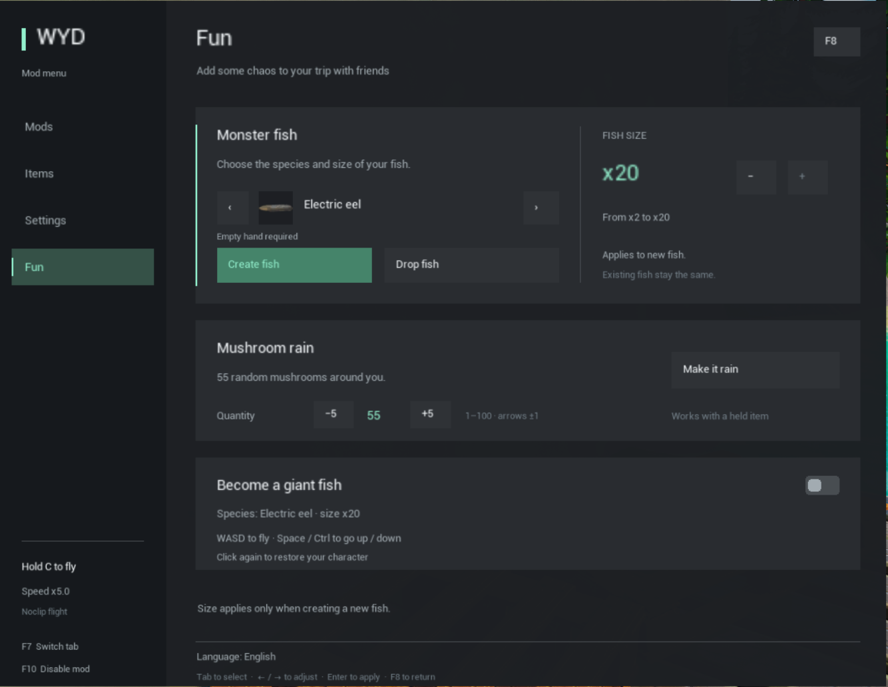

# Water You Doing? Mod Menu

An in-game cheat menu for [Water You Doing?](https://store.steampowered.com/app/4429930/Water_You_Doing/). Fly the boat, become a giant fish, make it rain mushrooms, or just spend less time waiting for a bite.

**[Download the BAT](https://github.com/Shightrox/water-you-doing-mod-menu/releases/latest/download/WaterYouModding.bat)** · [Watch the demo](https://github.com/Shightrox/water-you-doing-mod-menu/releases/download/v1.0.0/WaterYouModding-demo.mp4) · [Русская инструкция](README.ru.md)

Windows x64 · tested game build **1.0.6** · English by default, Russian available in Settings.

## What it does

| Feature | In the game |
| --- | --- |
| **Character and boat noclip** | Hold **C** to fly. At the helm, the same key moves the boat. Speed from **x0.5 to x10**, with **Shift** doubling it up to **x20**. Boat flight requires the host. |
| **Giant fish disguise** | Pick one of **9 fish**, set the size from **x2 to x20**, and become a flying fish. Other players see the fish instead of your character. You can still use normal tools. |
| **Monster fish** | Create a huge fish to hold or drop into the world. |
| **Mushroom rain** | Spawn **1–100** random mushrooms above and in front of you. Default: 15. Works while holding an item. |
| **Item spawner** | **48 items** in one searchable list, with icons where available and multiple category filters. Give an item to your hand or spawn it nearby. |
| **Fishing** | Fast bite, bigger catches, a choice of **9 species**, and protection against the fish breaking free. |
| **Boat supplies** | Add **10 wood** or **10 metal** to the boat's shared storage. |
| **Repair** | Repair hull panels and holes with one button, using the boat's stored materials. |
| **Fuel** | Infinite fuel for the host. Clients get a high-capacity fuel can instead. |

## How to run

1. Download **[WaterYouModding.bat](https://github.com/Shightrox/water-you-doing-mod-menu/releases/latest/download/WaterYouModding.bat)** from Releases.
2. Start the game and enter a session.
3. Double-click the BAT and wait for **Ready**.
4. Press **F8**. The menu supports the mouse, checkboxes, search, scrolling and sliders.

Run the BAT again after restarting the game. To update an already running mod, press **F10** first, then launch the new BAT. Language and settings are saved between launches.

## Controls

| Key | Action |
| --- | --- |
| **F8** | Open or close the menu |
| **F7** | Next menu tab |
| **F10** | Disable the mod |
| **Hold C** | Noclip: character on foot, boat at the helm |
| **WASD** on foot | Move relative to your view |
| **W / S** at the helm | Move bow-first / stern-first |
| **A / D** at the helm | Turn the boat |
| **Space / Ctrl** | Up / down while flying |
| **Shift** | Double the selected flight speed |

Mouse look stays free during boat flight. Looking sideways does not change the boat's direction of travel. Release **C** to return to normal movement.

In fish disguise, flight is continuous: use WASD and Space/Ctrl without holding C. Turn the disguise off in **Fun** to restore your character.

## Demo

[Watch or download the full 49-second demo](https://github.com/Shightrox/water-you-doing-mod-menu/releases/download/v1.0.0/WaterYouModding-demo.mp4) — mushroom rain, supplies, giant fish and flight. The recording uses the Russian UI; the menu also has a full English translation.

## Screenshots

Click an image to see the full-size capture.

| Mods | Items |
| --- | --- |
|  |  |
| **Settings** | **Fun** |
|  |  |

## A few things to know

- **Host and client features differ.** Boat flight and infinite fuel require the host. Item spawning, fishing, shared supplies and the fish/mushroom features were tested from a client as well. Friends can see the spawned objects and giant fish without installing the menu.
- **Empty your hand** before giving yourself an item, creating a monster fish or adding supplies. Mushroom rain can run with a held tool.
- **Repair spends materials.** It is not a free repair. The queue stops when you leave character control, including taking a seat.
- **The game keeps running while the menu is open.** Closing it returns control to the game.
- **F10 restores active movement and disguise changes.** It does not undo fish you caught, items you spawned or repairs already completed.
- **Offsets are build-specific.** This release was tested on the inspected Win64 **1.0.6** build. Other builds may need updated offsets.

The mod does not replace game files. It extracts its own files into `%LOCALAPPDATA%\WaterYouModding`. Settings and logs are in the `native-runtime` subfolder. To remove it, disable it with F10 and delete that folder and the BAT.

## For developers

[Build instructions and architecture](DEVELOPMENT.md) · [Offsets and layouts](docs/offsets.md) · [Machine-readable build reference](docs/build-1.0.6.json)

The runtime is a native C++ DLL with QuickJS and MinHook. The menu and feature logic live in `src/mod`; the launcher, memory bridge and hooks are in `src/native`. The sources build the same self-contained BAT distributed in Releases.

Bug reports are welcome in [Issues](https://github.com/Shightrox/water-you-doing-mod-menu/issues). Include the game version, mod version, whether you were hosting, and what happened.

Original mod code: [MIT](LICENSE). Bundled libraries: [third-party licenses](third_party/README.md). This is an unofficial mod, not a release from the game's developers.
