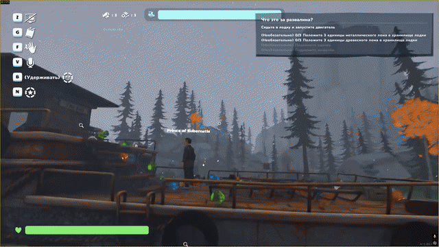

# Water You Doing? — меню модификаций

Полёт лодки, огромная рыба вместо персонажа, грибной дождь и несколько полезных кнопок для обычной игры.

**[Скачать BAT](https://github.com/Shightrox/water-you-doing-mod-menu/releases/latest/download/WaterYouModding.bat)** · [Видео](https://github.com/Shightrox/water-you-doing-mod-menu/releases/download/v1.0.0/WaterYouModding-demo.mp4) · [English](README.md)

Windows x64, проверенная сборка игры **1.0.6**. Первый запуск — на английском. Для русского: **F8 → Settings → Язык / Language → Русский**.

## Функции

| Функция | Что делает |
| --- | --- |
| **Noclip персонажа и лодки** | Держи **C**, чтобы лететь. За штурвалом та же клавиша управляет лодкой. Скорость **x0.5–x10**, с **Shift — до x20**. Полёт лодки работает у хоста. |
| **Стать огромной рыбой** | Выбор из **9 видов**, размер **x2–x20**. Друзья видят рыбу вместо персонажа; обычные инструменты продолжают работать. |
| **Рыба-монстр** | Создать огромный улов, взять в руку или положить рядом. |
| **Грибной дождь** | **1–100** случайных грибов сверху перед тобой, по умолчанию 15. Предмет из руки убирать не нужно. |
| **Выдача предметов** | **48 предметов** одним списком: поиск, несколько фильтров, доступные игровые иконки. Выдать в руку или заспавнить рядом. |
| **Рыбалка** | Быстрая поклёвка, крупная рыба, выбор одного из **9 видов** и защита от срыва. |
| **Материалы** | **Дерево +10** и **Металл +10** в общий запас корабля. |
| **Ремонт** | Починить корпус и пробоины одной кнопкой, с расходом материалов из ящиков. |
| **Топливо** | Бесконечное топливо у хоста; у клиента — канистра с большим запасом. |

## Запуск

1. Скачай **[WaterYouModding.bat](https://github.com/Shightrox/water-you-doing-mod-menu/releases/latest/download/WaterYouModding.bat)** из Releases.
2. Запусти игру и зайди в сессию.
3. Открой BAT и дождись **Ready**.
4. Нажми **F8**. Меню работает мышью: кнопки, галочки, поиск, прокрутка и ползунки.

Всё нужное находится внутри BAT. Python, Frida и отдельный модлоадер не нужны.

После перезапуска игры BAT нужно запустить снова. Для обновления уже включённого мода сначала нажми **F10**, затем запусти новый BAT. Выбранные настройки и язык сохраняются.

## Управление

| Клавиша | Действие |
| --- | --- |
| **F8** | Открыть или закрыть меню |
| **F7** | Следующая вкладка |
| **F10** | Отключить мод |
| **Удерживать C** | Noclip персонажа; за штурвалом — лодки |
| **WASD** пешком | Движение по направлению взгляда |
| **W / S** за штурвалом | Носом вперёд / кормой назад |
| **A / D** за штурвалом | Поворот лодки |
| **Space / Ctrl** | Вверх / вниз в полёте |
| **Shift** | Удвоить выбранную скорость |

Мышь свободно вращает камеру при полёте лодки. Направление W/S остаётся привязанным к носу. Отпускание C возвращает обычное управление.

В рыбьем облике C держать не нужно: полёт постоянный, управление — WASD и Space/Ctrl. Выключи облик во вкладке «Приколы», чтобы вернуть персонажа.

## Видео и скриншоты

[Полный ролик, 49 секунд](https://github.com/Shightrox/water-you-doing-mod-menu/releases/download/v1.0.0/WaterYouModding-demo.mp4) · [Скриншоты всех четырёх вкладок](README.md#screenshots)

## Что учитывать

- Полёт лодки и бесконечное топливо требуют хоста. Выдача предметов, рыбалка, пополнение склада и приколы с рыбой и грибами проверялись и у клиента. Друзьям мод не нужен, чтобы видеть созданные предметы и огромную рыбу.
- Для обычной выдачи, создания рыбы-монстра и пополнения материалов нужна пустая рука. Грибной дождь работает с предметом в руке.
- Ремонт расходует материалы и останавливается при смене управления, например при посадке за штурвал.
- При открытом меню игра продолжает идти.
- F10 восстанавливает движение и облик, но уже созданные предметы, улов и выполненный ремонт остаются в мире.
- Поддержка проверена на конкретной Win64-сборке **1.0.6**. Другим сборкам могут потребоваться новые офсеты.

Файлы игры не заменяются. Мод распаковывается в `%LOCALAPPDATA%\WaterYouModding`, настройки и журнал лежат в `native-runtime`. Для удаления выключи мод через F10 и удали BAT и эту папку.

## Для разработчиков

[Сборка и устройство проекта](DEVELOPMENT.md) · [Офсеты](docs/offsets.md) · [Параметры проверенной сборки](docs/build-1.0.6.json)

Оригинальный код — [MIT](LICENSE), лицензии встроенных библиотек — [здесь](third_party/README.md). Это неофициальный мод.
